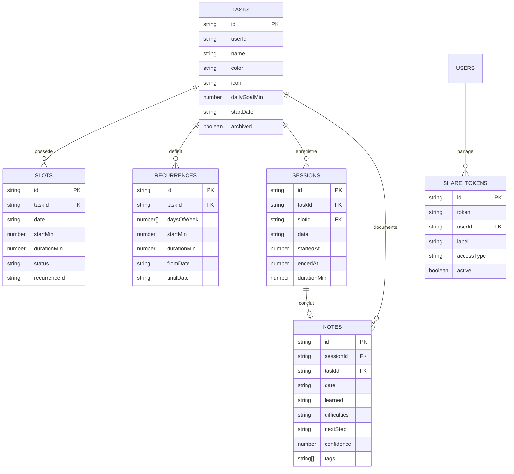

# Araho ⏱️🧠

> **« Planifie, progresse, documente. »**  
> Une application personnelle de **time-blocking**, de **suivi de sessions**, de **journal d'apprentissage réflexif** et de **révision espacée**, conçue avec l'exigence esthétique et ergonomique de l'écosystème Apple (iOS & macOS).

---

## 🌟 Philosophie & Vision

La plupart des applications de productivité souffrent de deux écueils majeurs :
1. **Les to-do lists** accumulent des tâches sans allouer le temps réel nécessaire pour les exécuter.
2. **Les calendriers classiques** bloquent du temps mais ne gardent aucune mémoire qualitative de ce qui a été accompli ou appris.

**Araho** comble ce fossé en créant un cercle vertueux d'apprentissage :
* **Structurer** : découper ses journées en créneaux clairs (ponctuels ou récurrents).
* **Focaliser** : exécuter chaque session avec un timer immersif façon Apple Watch.
* **Capitaliser** : documenter immédiatement ce qui a été appris (*Ce que j'ai appris*, *Difficultés rencontrées*, *Prochaine étape*).
* **Ancrer** : consolider ses connaissances sur le long terme grâce à un algorithme de répétition espacée.
* **Partager** : donner accès à son planning en lecture seule à ses proches (ex: sa petite amie) pour coordonner leurs temps libres sans dévoiler ses notes intimes.

---

## ✨ Fonctionnalités Détaillées

### 1. 📅 Vue Aujourd'hui & Navigation Temporelle
* **Timeline quotidienne dynamique** : affichage vertical de tous les créneaux avec curseur visuel en temps réel de l'heure actuelle (*« Maintenant »*).
* **Barre d'objectifs journaliers** : jauge dynamique comparant le temps réalisé au temps planifié pour la journée.
* **Lancement rapide** : bouton de démarrage immédiat d'une session directement depuis chaque créneau.
* **Widget d'ancrage mémoriel** : carte intelligente sur l'écran d'accueil qui alerte l'utilisateur lorsqu'il a des apprentissages à réactiver aujourd'hui (~2 min).

### 2. ⏱️ Session en cours & Focus Immersif
* **Timer épuré plein écran** : interface minimaliste sans distractions avec anneau de progression, chrono fluide, gestion des pauses et temps prévu.
* **Mini-lecteur persistant (Session Dock)** : bandeau rétractable en bas de l'application permettant de naviguer dans ses notes ou son planning sans jamais interrompre la session active.
* **Carillon zen & Fin de session** : à la fin du temps imparti, un carillon harmonique 4 notes (Web Audio API synthétisée 100% hors-ligne) résonne doucement et une notification système invite à rédiger son bilan.

### 3. 📝 Fiche réflexive & Journal d'apprentissage
* **Capture d'apprentissage à chaud** :
  * 💡 *Ce que j’ai appris* (synthèse en texte libre).
  * ⚠️ *Difficultés rencontrées* (blocages, erreurs résolues).
  * 🎯 *Prochaine étape* (facilite la reprise lors de la session suivante).
  * ⭐ *Niveau de compréhension* (auto-évaluation de 1 à 5 étoiles).
  * 🏷️ *Tags thématiques* pour organiser ses compétences.
* **Recherche et filtres** : filtrage instantané par tâche, par tag et par recherche textuelle intégrale.
* **Export Markdown (.md)** : export en 1 clic de tout le journal ou d'une tâche précise vers un document `.md` structuré avec frontmatter YAML, prêt pour **Obsidian**, **Notion** ou une archive personnelle.

### 4. 📆 Calendrier & Planning Hebdomadaire
* **Inspiration Calendrier iOS** : bandeau de défilement des 7 jours (Dimanche à Samedi) avec pastilles d'activité et raccourci « Aujourd'hui ».
* **Double affichage** : bascule fluide entre une vue Timeline chronologique horaire (5h à 23h) et une vue Liste compacte.
* **Gestion des récurrences** : planification d'horaires fixes (ex : *tous les mardis et jeudis de 18h à 19h*) matérialisés à la volée.

### 5. 📊 Bilan Hebdomadaire (Weekly Review)
* **Revue de la semaine façon Apple Forme / Temps d'écran** :
  * Temps cumulé total sur la semaine avec calcul de l'évolution vs la semaine précédente (`+X%` / `-X%`).
  * 4 indicateurs clés : *Jours actifs sur 7*, *Jour record*, *Volume de notes*, *Compréhension moyenne*.
  * Histogramme d'activité quotidien sur les 7 jours.
  * Répartition détaillée par tâche avec barres de progression colorées aux couleurs personnalisées de chaque tâche.
  * Synthèse chronologique des notes et découvertes de la semaine.
  * Bouton d'export Markdown du rapport hebdomadaire.

### 6. 🧠 Système de Révision Espacée (Spaced Repetition)
* **Algorithme d'espacement cognitif** : basé sur la courbe de l'oubli d'Ebbinghaus et le niveau de confiance initial (échelons progressifs de 1j, 3j, 7j, 14j, 30j, 60j).
* **Cartes mémoires interactives (Flashcards)** :
  * Rappel actif : invite à se remémorer mentalement les notions avant de retourner la carte.
  * Révélation claire des apprentissages, des difficultés et des prochaines étapes.
  * Notation rapide : **« À revoir (1 j) »** réinitialise le palier, **« Bien assimilé (+X j) »** espace la prochaine révision.

### 7. ⏰ Rappels de créneau (Web Notifications)
* **Anticipation 5 minutes avant** : surveillance en arrière-plan vérifiant les créneaux prévus d'aujourd'hui.
* **Carillon doux à 2 notes & Notification push web** : alerte discrète pour préparer son espace de travail sans stress.
* **Système anti-doublon** : garantit qu'un créneau n'alerte qu'une seule fois par jour.
* **Réglages dédiés** : interrupteurs iOS dans les réglages pour activer/désactiver le son, les notifications, et tester l'alerte.

### 8. 💑 Partage de planning en lecture seule (Pour proches / Petite amie)
* **Lien secret tokenisé** : génération d'un lien public sécurisé en lecture seule (`/share/:token`).
* **Visibilité respectueuse** :
  * Affiche la grille de la semaine avec distinction claire entre les créneaux occupés et les plages de **temps libre**.
  * Préserve la confidentialité : **aucune note intime ni contenu d'apprentissage n'est partagé**.
* **Accès universel** : consultable sur n'importe quel smartphone ou ordinateur sans nécessiter de compte.

### 9. 🎨 Design System Apple & Expérience Native
* **Esthétique iOS / macOS pure** : respect strict des directives de design Apple (SF Pro Text/Display, coins arrondis `10px`/`12px`, typographie hiérarchisée, couleurs système HSL vibrantes, micro-animations réactives).
* **Mode Sombre, Clair et Automatique** : sélecteur d'apparence dans les réglages avec bascule immédiate sans aucun flash blanc au chargement (`data-theme`).
* **PWA Installable** :
  * Sur iPhone (Safari) : s'installe sur l'écran d'accueil en **vrai plein écran** (sans barre d'adresse ni navigation Safari).
  * Sur Mac (Safari / Chrome) : s'ajoute au Dock comme une application de bureau.
* **Audio Web synthétisé** : génère des carillons acoustiques sinusoïdaux en direct via la Web Audio API sans charger de gros fichiers audio externes.

---

## 🛠️ Stack Technique

| Domaine | Technologie | Justification |
|---|---|---|
| **Frontend** | React 18 / 19, TypeScript | Typage strict, composants déclaratifs, réactivité. |
| **Bundler** | Vite 8 + Oxlint | Temps de compilation instantané, HMR ultrarapide. |
| **Styles** | Vanilla CSS (Tokens & Variables) | Zéro surcharge de framework (aucun Tailwind), 100% fidèle au design Apple natif. |
| **Base de données locale** | Dexie.js (IndexedDB) | Architecture **Local-First** : fonctionne hors connexion, réactivité instantanée. |
| **Cloud & Auth** | Supabase (PostgreSQL) | Comptes sécurisés (JWT), Row Level Security (RLS), synchronisation en temps réel. |
| **Audio** | Web Audio API | Synthèse harmonique 100% hors-ligne, zéro latence, zéro asset externe. |
| **PWA** | Vite PWA + Service Worker | Mise en cache intelligente Workbox, installation écran d'accueil. |
| **Icônes** | Lucide React | Icônes fines et harmonieuses de style iOS SF Symbols. |
| **Déploiement** | Vercel | Hébergement Edge ultra-rapide, HTTPS automatique, CI/CD sur git push. |

---

## 📁 Architecture du Projet

```text
araho/
├── public/
│   ├── favicon.ico
│   ├── icons/                 # Icônes PWA Apple Touch (64x64, 192x192, 512x512)
│   └── manifest.webmanifest   # Configuration PWA pour l'écran d'accueil
├── src/
│   ├── components/            # Composants réutilisables d'UI
│   │   ├── ui.tsx             # En-têtes iOS, Sections groupées, TaskIcon, Badges
│   │   ├── AppShell.tsx       # Shell applicatif (Sidebar Mac, Tabbar iPhone, Dock)
│   │   └── components.css     # Styles des composants natifs Apple
│   ├── db/                    # Couche d'accès aux données (Local-First)
│   │   ├── db.ts              # Schéma et initialisation Dexie (IndexedDB)
│   │   ├── types.ts           # Types TypeScript (Task, Slot, Session, Note, etc.)
│   │   ├── repo.ts            # CRUD, calculs des créneaux récurrents et sessions
│   │   ├── hooks.ts           # Hooks réactifs useLiveQuery pour React
│   │   ├── stats.ts           # Moteur statistique (streaks, bilan hebdomadaire)
│   │   ├── sync.ts            # Synchronisation bi-directionnelle Dexie <-> Supabase
│   │   └── share.ts           # Gestion des tokens de partage
│   ├── features/              # Découpage modulaire par domaine fonctionnel
│   │   ├── today/             # Vue du jour, timeline, repère "Maintenant"
│   │   ├── week/              # Calendrier 7 jours, revue hebdomadaire (WeeklyReviewSheet)
│   │   ├── tasks/             # Liste des tâches, création, édition, vue détaillée
│   │   ├── session/           # Chronomètre plein écran, carillon, formulaire bilan
│   │   ├── journal/           # Journal global, révision espacée (SpacedReviewSheet)
│   │   ├── settings/          # Réglages (thème, synchro cloud, rappels, sauvegarde JSON)
│   │   ├── auth/              # Feuille de connexion et d'inscription Supabase
│   │   └── share/             # Vue publique partagée pour les proches (/share/:token)
│   ├── lib/                   # Utilitaires & Moteurs transverses
│   │   ├── date.ts            # Manipulation des dates ISO (formatage, semaines, créneaux)
│   │   ├── sound.ts           # Synthétiseur de carillons Web Audio & notifications
│   │   ├── reminders.ts       # Surveillance et alerte de début de créneau (5 min avant)
│   │   ├── spacedRepetition.ts# Algorithme d'ancrage mémoriel SM-2/Leitner
│   │   ├── exportMarkdown.ts  # Générateur de rapports Markdown (Obsidian / Notion)
│   │   ├── theme.ts           # Gestionnaire du mode Sombre / Clair / Auto
│   │   └── supabase.ts        # Client Supabase et gestion de session utilisateur
│   ├── styles/                # Design tokens & styles globaux
│   │   ├── tokens.css         # Variables CSS Apple (couleurs, surfaces, polices, thèmes)
│   │   ├── base.css           # Reset moderne, typographie et grille de 8px
│   │   └── pages.css          # Styles spécifiques aux pages et vues
│   ├── App.tsx                # Configuration des routes (React Router)
│   └── main.tsx               # Point d'entrée de l'application React
├── supabase/
│   └── schema.sql             # Schéma SQL complet PostgreSQL, RLS, index et fonctions RPC
├── vercel.json                # Règles de réécriture pour le routage SPA sur Vercel
├── vite.config.ts             # Configuration Vite & plugin PWA
└── package.json               # Scripts et dépendances
```

---

## 🗄️ Modèle de Données

Les données sont gérées localement avec **Dexie** et synchronisées sur **Supabase** :



---

## 🚀 Démarrage Rapide

### Prérequis
* **Node.js** version 18 ou supérieure.
* **npm** ou **pnpm**.

### 1. Cloner le projet & Installer les dépendances
```bash
git clone https://github.com/AnjahNyOny/araho.git
cd araho
npm install
```

### 2. Configuration des Variables d'Environnement
Copiez le fichier d'exemple `.env.example` en `.env` :
```bash
cp .env.example .env
```

Renseignez vos clés Supabase dans `.env` :
```env
VITE_SUPABASE_URL=https://votre-projet.supabase.co
VITE_SUPABASE_ANON_KEY=votre-cle-anon-publique
```

### 3. Lancer le Serveur de Développement
```bash
npm run dev
```
L'application est accessible sur : `http://localhost:5173`

### 4. Build de Production
Pour valider le typage TypeScript et générer les fichiers optimisés pour la production :
```bash
npm run build
```

---

## ☁️ Déploiement sur Vercel

Le projet est configuré pour un déploiement instantané sur **Vercel** :

1. Importez votre dépôt GitHub sur **[vercel.com/new](https://vercel.com/new)**.
2. Ajoutez les 2 variables d'environnement dans les réglages du projet Vercel :
   * `VITE_SUPABASE_URL`
   * `VITE_SUPABASE_ANON_KEY`
3. Déployez. Grâce à [`vercel.json`](file:///Users/mac/Projects/araho/vercel.json), le routage des pages directes et des liens partagés (`/share/:token`) fonctionne parfaitement sans erreur 404.

---

## 📱 Installation sur iPhone (PWA)

1. Ouvrez l'URL de votre application déployée dans **Safari** sur votre iPhone.
2. Touchez le bouton **Partager** en bas de l'écran (l'icône carrée avec une flèche vers le haut ⎋ / ⬆️).
3. Faites défiler et sélectionnez **« Sur l’écran d’accueil »** (icône `+`).
4. Touchez **« Ajouter »**.

> **Résultat** : Araho s'exécute en véritable plein écran natif (sans interface Safari), reste accessible même sans réseau, et préserve toutes vos données en local.

---

## 🔒 Confidentialité & Sauvegarde

* **Local-First** : vos données sont toujours stockées sur votre appareil via IndexedDB. Même sans connexion internet, l'application reste 100% opérationnelle.
* **Export JSON universel** : vous pouvez à tout moment exporter une sauvegarde complète de toutes vos données en un fichier `.json` depuis l'onglet **Réglages** > *Exporter une sauvegarde JSON*.
* **Partage sécurisé** : les liens partagés avec vos proches n'ont accès qu'à votre planning anonymisé via une fonction PostgreSQL sécurisée (`get_shared_schedule`). Vos notes d'apprentissage restent strictement privées.

---

## 📄 Licence

Ce projet est sous licence MIT. Libre à vous de l'adapter et de l'utiliser pour structurer vos apprentissages personnels.
